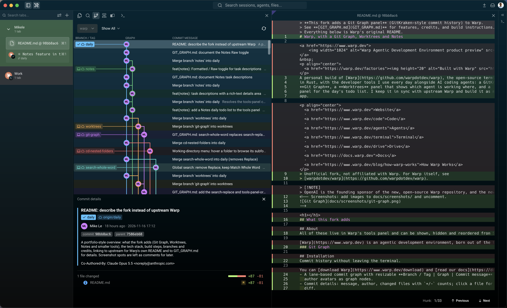
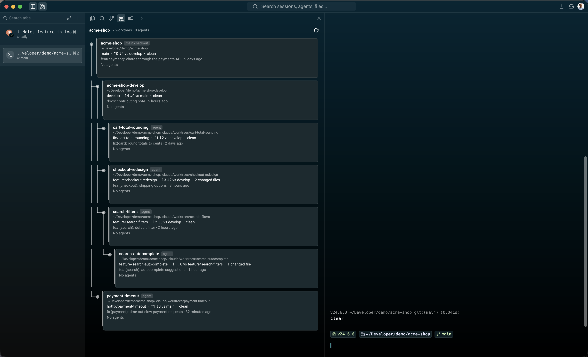
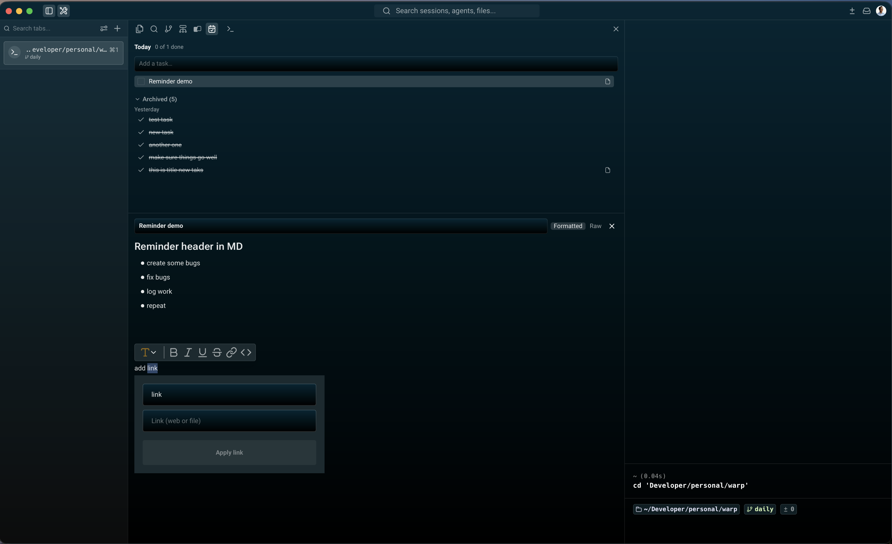

# Warp, with a Git Graph, Worktrees and Notes

A personal build of [Warp](https://github.com/warpdotdev/warp), the open-source terminal written
in Rust, with the developer tools I use every day alongside AI coding agents: a GitKraken-style
**Git Graph**, a **Worktrees** panel that shows which agent is working where, and a **Notes**
panel for the day's todo list. I keep it in sync with upstream Warp and build it as my own macOS
app.

> Unofficial fork, not affiliated with Warp. For Warp itself, see
> [warpdotdev/warp](https://github.com/warpdotdev/warp).

## What this fork adds

All of these live in Warp's tools panel and can be shown, hidden and reordered from Settings.

### Git Graph

Commit history without leaving the terminal.



- A lane-based commit graph with resizable **Branch / Tag | Graph | Commit message** columns and
  author avatars as graph nodes.
- Commit details: message, author, changed files with `+/-` counts; click a file for a read-only
  diff.
- Stage, unstage and commit from the uncommitted-changes row.
- Right-click git operations (checkout, branch and tag management, merge, rebase, reset,
  cherry-pick, revert, push/pull, stashes), each confirmed before it runs.
- Auto-refresh when the repository changes, a branch filter, and a picker for folders with
  several repositories.

### Worktrees

For agent-heavy workflows where several git worktrees branch off the same base.



- Every worktree of the repository hangs under the branch it was created from, read from the
  branch's reflog.
- Each card shows the branch, commits ahead/behind, uncommitted changes, and the Claude Code
  sessions running in it with their state (working, needs you, idle).
- Click a card to open a terminal in that worktree.

### Notes

A daily todo list next to the terminal.



- Add tasks, tick them off, and move finished ones to an archive grouped by the day they were
  done.
- Click a task to open its details: a title and a rich-text description (headings, lists, code
  blocks with syntax highlighting, a `/` block menu), with a **Formatted | Raw** markdown toggle.
- One list shared by every window, saved locally as you type.

### Smaller additions

Reorderable tools-panel buttons, split-pane tools (collapse a pane to a strip, open files beside
the terminal), whole-word global search, browsing subfolders from the working-directory menu,
alternating block backgrounds, colored file icons, and two themes (Samurai and Sakura).

Full feature notes, build steps and how the fork is maintained: **[GIT_GRAPH.md](GIT_GRAPH.md)**.

## Tech stack

| Area | Technology |
|---|---|
| Language | Rust, in a Cargo workspace of about 80 crates |
| UI | WarpUI, Warp's own GPU-rendered UI framework (Flutter-inspired layout, entity/handle state model) |
| Rendering | wgpu with WGSL shaders; Metal on macOS |
| Platform | winit, native macOS APIs through objc2; Linux and Windows builds |
| Terminal | vte-based escape-sequence parsing, pty in a separate terminal-server process |
| Async | tokio and futures; git and file work runs off the UI thread |
| Data | SQLite via Diesel, serde, GraphQL via cynic, protobuf via prost |
| Quality | unit tests (cargo-nextest), Clippy with `-D warnings`, rustfmt |

Highlights from building the fork:

- **Readable graphs on busy repositories:** stashes attach to their base commit instead of
  opening lanes that never close (one repository needed 168 lanes before the fix).
- **Safe git calls:** branch and tag names are passed as fully qualified refs after
  `--end-of-options` and validated before git runs.
- **Safe local data:** Notes writes atomically (temp file and rename) and refuses to overwrite a
  file it can't read.
- **Upstream bug fix:** tools-panel buttons were matched to their mouse state by position, so a
  fifth panel's button silently disappeared.

## Building

macOS, with Xcode, Rust via `rustup`, `brew install protobuf pkgconf` and
`cargo install --locked cargo-bundle@0.11.0`:

```sh
git switch daily
WARP_SKIP_COMMON_SKILLS_INSTALL=1 ./script/run --features git_graph,open_directory_in_external_editor
```

This opens **WarpOss**, which keeps its settings in `~/.warp-oss` and doesn't touch an installed
Warp. `script/macos/personal_dmg` builds a signed release app as a DMG. Details in
[GIT_GRAPH.md](GIT_GRAPH.md).

## Branches

Each feature has its own branch, and **`daily`** combines them into the build I use. `git-graph`
contains only the Git Graph, kept ready to propose upstream. The full branch map is in
[GIT_GRAPH.md](GIT_GRAPH.md#branches).

## Credits

The Git Graph panel was started by [@0xBB2B](https://github.com/0xBB2B) in
[warpdotdev/warp#12043](https://github.com/warpdotdev/warp/pull/12043); I brought it up to date
with upstream and extended it. Everything else is built on Warp's open-source codebase.

## License

Same as Warp: AGPL-3.0 (with MIT-licensed parts); see [LICENSE-AGPL](LICENSE-AGPL) and
[LICENSE-MIT](LICENSE-MIT). GitKraken and Warp are trademarks of their respective owners; this
project is not affiliated with or endorsed by either.
